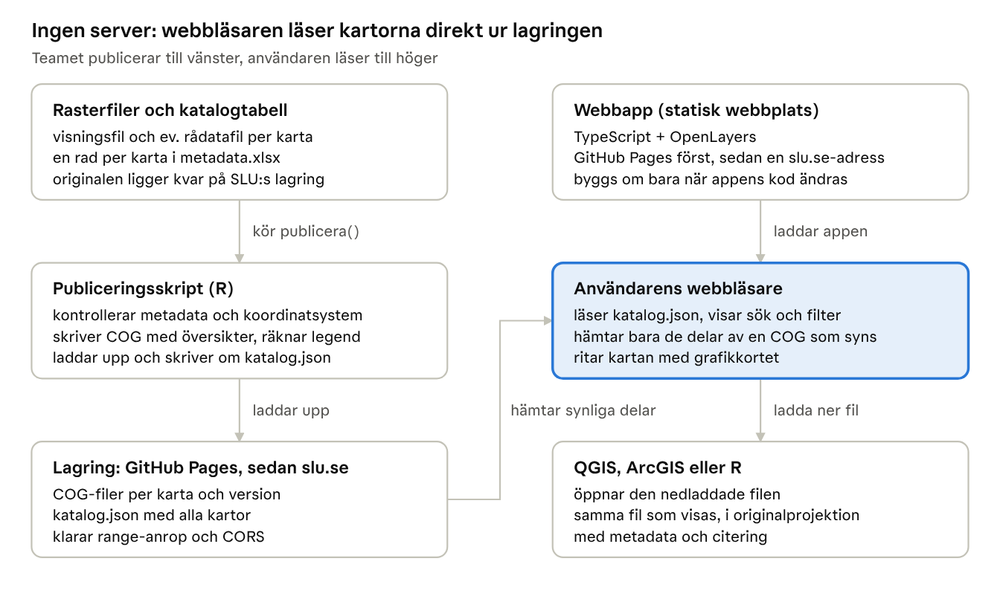
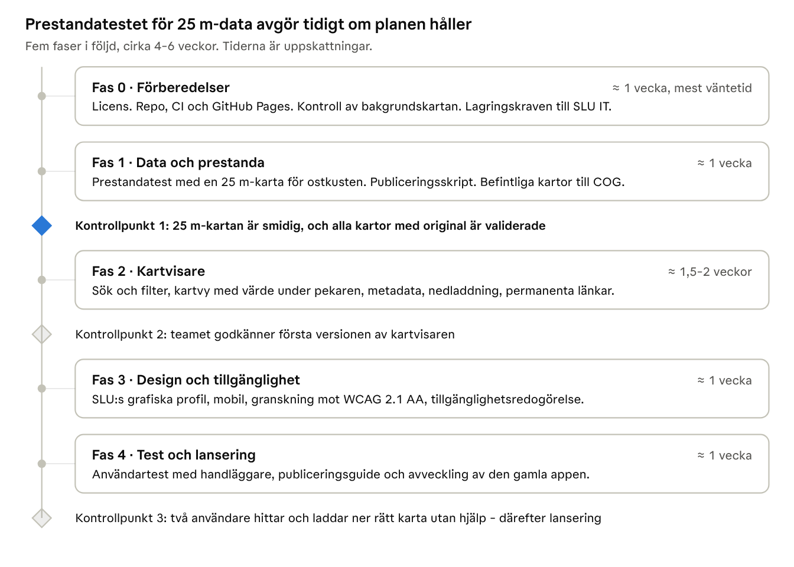

# Modernisering av kartappen – bedömning och plan

Nov 25, 2026 · @Mårten

## Sammanfattning

Vi skriver om appen, men inte som en ny serverapp. Den blir en **statisk kartportal**: kartorna ligger som Cloud-Optimized GeoTIFF (COG) på en vanlig webbserver och ritas i webbläsaren. Det tar bort orsaken till kraschen, klarar de kommande 25 m-kartorna över hela kusten och kostar nästan ingenting. En ny karta publiceras genom att man fyller i en metadatarad och kör ett skript. Ingen behöver röra appens kod.

- **Beslutat:** alternativ A (statisk webbplats + COG i molnlagring). Analys-fliken tas bort i första versionen och läggs tillbaka om kollegorna vill ha den.

- **Portalen gör tre saker:** visar kartor i full upplösning, visar metadata och låter användaren ladda ner kartfiler och rådata.

- **Kostnad:** inga molnavgifter. Vi börjar på GitHub Pages och flyttar till en slu.se-adress när SLU:s del är på plats. Det finns ingen server med applogik att drifta.

- **Insats (uppskattning):** 4–6 veckors arbetstid fördelat på fem faser, med kontrollpunkter längs vägen. Kalendertiden blir sannolikt längre.

- **Öppet:** var kartdatan ska ligga på sikt (behövs innan 25 m-kartorna publiceras) och slutligt beslut om licens (CC BY 4.0 gäller preliminärt). Övriga frågor besvarades den 25 november.

## Nuläge

Den nuvarande appen (app.R, cirka 500 rader) kraschar på grund av hur den hanterar rastren. Felet ligger inte i R som språk. Den körs på shinyapps.io under två konton (martenerlandsson och vindfisk).

**Varför den slår i minnestaket**

- Vid start läses alla 92 kartlager in som ett enda float32-raster (1018 × 810 celler per lager). Det tar ungefär 300 MB minne innan någon har klickat. Gratisnivån ger 1 GB per instans och 25 aktiva timmar per månad.

- Vid varje val projicerar servern om rastret (addRasterImage(project = TRUE)) och skickar det som en bild. I Analys-fliken summeras dessutom flera lager, och då skapas fler kopior i minnet.

- Kartexporten laddar html2canvas från en extern länk och bygger på manuellt inställda pixelförskjutningar. Den är skör.

**Vad användaren faktiskt får**

- Visningen och nedladdningen bygger på ett ihopräknat rutnät om ungefär 0,014° (cirka 1–1,5 km) i WGS84. Det är klassat till två värden (5/10). Knappen ”Ladda ned raster” ger alltså inte originalfilerna.

- Originalen är mer detaljerade och kontinuerliga, men spretiga:

| Källa                | Antal kartor | Upplösning                    | Koordinatsystem                               | Kontinuerlig fil (rådata)                            | Klassad fil i originalupplösning |
|----------------------|--------------|-------------------------------|-----------------------------------------------|------------------------------------------------------|----------------------------------|
| NMK Trål             | 26           | cirka 0,056 × 0,033°          | WGS84 (EPSG:4326)                             | biomod2-ensemble, 0–1000 (int16), plus TSS-binär fil | Finns, 5/10 (uint8)              |
| NMK Ryssja           | 22           | 250 m                         | ETRS89 / UTM 33N (EPSG:25833)                 | Kontinuerlig (float32)                               | Finns, 5/10 (uint8)              |
| NMK Yngel            | 19           | 250 m                         | ETRS89-LAEA (angiven som IGNF-kod, inte EPSG) | Kontinuerlig (uint32)                                | Finns, 5/10 (uint8)              |
| PanBalticScope       | 8            | 1 km                          | Web Mercator (EPSG:3857)                      | Klasser 0/0,5/1 (float32)                            | Finns, 0/5/10                    |
| Utan original (2025) | 16           | Finns bara i 1,5 km-versionen | –                                             | Saknas                                               | Saknas                           |

**Klassningsregeln** framgår av datahandling.R och av filerna. Celler under en artspecifik förekomstgräns tas bort: för Trål är gränsen en TSS-tröskel från biomod2, för Ryssja ett fast värde per art. De celler som återstår delas vid medianen, så att värden under medianen blir 5 (viktigt) och värden över medianen blir 10 (mycket viktigt). PanBalticScope levereras som 0/0,5/1 och multipliceras med 10. Där betyder 0 ”ej viktigt område”. Klassade filer i originalupplösning finns redan för de 75 kartor som har original (Data not in app/data/data/rst/). De behöver alltså inte klassas om. Appen i dag visar samma filer, men omprojicerade till PanBalticScopes 1 km-rutnät med maxvärde och därefter aggregerade en gång till.

- Lagren består mest av ”ingen data”. I de kontrollerade filerna har 1–18 % av cellerna värden. Komprimerade filer blir därför små jämfört med cellantalet.

**Metadata och repo**

- metadata.xlsx har 91 rader och 23 kolumner, bland annat art, livsstadium, havsområde, källa, citering, år, kvalitet, rödlistestatus och Fiskbarometern. Det är en bra grund för en katalog. Språket är blandat: kvalitetstexterna för PanBalticScope är på engelska.

- Repot innehåller dubbla datamappar (data/rst, data/rst final, data/data/...) och oanvända .rds-filer. All data ligger i git-historiken, cirka 32 MB.

## Är en omskrivning värd det?

Ja. De krav som tillkommer – 25 m-kartor över hela kusten, kartor från många projekt och nedladdning av originaldata – går inte att uppfylla med en server som läser in rastren i minnet. En statisk portal löser alla tre på en gång.

- **Vi vinner:** inga krascher, eftersom det inte finns någon server som kan ta slut på minne. Full upplösning när man zoomar in. Nära noll kostnad. Nya kartor kräver ingen ändring i appens kod.

- **Vi tappar:** Analys-fliken (medvetet val, kan läggas tillbaka i webbläsaren senare) och att hela verktyget är R. Webbappen skrivs i TypeScript. Publiceringsskriptet kan däremot vara R, så det dagliga arbetet – att lägga till kartor – stannar i ett språk som teamet redan kan.

- **Bortvalt:** att optimera Shiny-appen. Den skulle krascha mindre, men skulle fortfarande vara bunden av gratisnivåns 1 GB och 25 aktiva timmar, och skulle inte klara 25 m-data i full upplösning.

## Mål, icke-mål och krav

Portalen ska låta en handläggare hitta rätt karta, förstå hur säker den är och ladda ner den, utan att vi behöver svara på mejl.

**Användare** (bekräftat): främst handläggare som använder kartorna som underlag i sina ärenden, därefter forskare och kollegor på SLU Aqua. De flesta är inte GIS-experter men har QGIS eller ArcGIS för nedladdade filer.

**Mål**

1.  Hitta en karta via sök och filter: projekt, art, livsstadium, havsområde, källa, år, rödlistestatus, Fiskbarometern, livsmiljö och simblåsa.

2.  Visa kartan i full upplösning (ned till 25 m) med mjuk panorering och zoom. Visa värdet under muspekaren. Den klassade versionen visas som standard, och den kontinuerliga kan väljas.

3.  Visa metadata bredvid kartan: beskrivning, kvalitet och osäkerhet, citering, år, källa och kontaktperson.

4.  Ladda ner visningsfilen, rådatafilen och metadatan. Filerna ska vara exakt de som publicerats, i originalprojektion.

5.  Varje karta får en permanent länk som går att klistra in i ett beslut eller en rapport.

6.  Teamet publicerar en ny karta med en metadatarad och ett skript. Ingen kodändring behövs. Ett lager kan döljas utan att det raderas.

7.  Professionellt intryck: SLU:s grafiska profil, fungerar på mobil, uppfyller tillgänglighetskraven för offentliga webbplatser (DOS-lagen, WCAG 2.1 AA). Gränssnittet är på svenska med engelska som val.

**Icke-mål i version 1**

- Analys: summering av flera kartor, uppladdning av egna polygoner.

- Inloggning, behörigheter och redigering i webbläsaren.

- WMS- eller WMTS-tjänst för GIS-program. Det kan läggas till senare på samma filer.

**Detta får inte hända** (även om allt annat fungerar)

- Att användaren tror att hen laddar ner originalet men får en nedskalad version.

- Att det krävs en utvecklare för att lägga till en karta.

- Att en karta publiceras utan metadata, citering eller angivet koordinatsystem.

**Begränsningar**

- Ingen server som vi driftar. Allt ska kunna ligga på statisk hosting och objektlagring.

- 25 m-kartorna kommer för 20 arter, både klassade och kontinuerliga, som en fil per karta för hela ostkusten i SWEREF 99 TM (EPSG:3006). Varje lager kan bli omkring en miljard celler.

- Källdata kommer i blandade koordinatsystem, datatyper och upplösningar.

## Alternativ som vi har vägt

Vi valde A. Det är det enda alternativet som klarar 25 m-data utan en server och ändå bara lagrar en kopia av varje karta.

| Alternativ                                               | Så fungerar det                                                                                                              | Fördelar                                                                                               | Nackdelar                                                                                                           | Beslut                                                  |
|----------------------------------------------------------|------------------------------------------------------------------------------------------------------------------------------|--------------------------------------------------------------------------------------------------------|---------------------------------------------------------------------------------------------------------------------|---------------------------------------------------------|
| **A. Statisk webbplats + COG i molnlagring**             | En COG per karta, med översikter. Webbläsaren hämtar bara de delar som syns vid aktuell zoom och ritar dem med grafikkortet. | En kopia av datan. Exakta värden under muspekaren. Färger kan ändras utan omprocessning. Ingen server. | Webbläsaren gör ritjobbet, vilket kan bli långsammare på mycket gamla datorer.                                      | **Valt**                                                |
| B. Statisk webbplats + förrenderade kartbilder (PMTiles) | Kartbilder i alla zoomnivåer renderas i förväg. Nedladdningsfilerna ligger separat.                                          | Mjukast på svaga enheter.                                                                              | Två kopior av varje karta. Färgerna är inbakade. Inga exakta värden under muspekaren. Tungt byggsteg för 25 m-data. | Bortvalt                                                |
| C. Kartserver (GeoServer eller TiTiler)                  | En server ritar kartbilder på begäran (WMS/WMTS).                                                                            | GIS-program kan lägga in kartorna direkt.                                                              | En server att drifta och patcha igen. Kostnad.                                                                      | Bortvalt nu. Kan läggas till senare på samma COG-filer. |
| Optimera Shiny-appen                                     | Mindre raster och ingen omprojicering i appen.                                                                               | Minst förändring.                                                                                      | Samma minnes- och timgränser. Klarar inte 25 m-data.                                                                | Bortvalt                                                |
| ArcGIS Online eller Hub                                  | Publicera från ArcGIS Pro.                                                                                                   | Enkelt att publicera, professionellt utseende.                                                         | Licens och krediter, inlåsning hos en leverantör, begränsad egen styrning.                                          | Bortvalt, om inte SLU redan publicerar där              |

## Rekommenderad arkitektur

Ingen del av portalen kräver en server som vi driftar. Teamet publicerar filer till lagringen, och användarens webbläsare läser dem direkt därifrån.

arkitektur · sex delar, ingen server

Den fil som visas i webbläsaren är samma fil som användaren laddar ner. Det gör att visningen och nedladdningen aldrig kan visa olika saker.

**Teknikval** (Claudes förslag; de val som påverkar teamet mest är R för publiceringen och Svelte för gränssnittet)

| Del              | Val                                                                                                | Varför                                                                                 |
|------------------|----------------------------------------------------------------------------------------------------|----------------------------------------------------------------------------------------|
| Kartmotor        | OpenLayers (WebGL-lager med GeoTIFF-källa)                                                         | Läser COG direkt via range-anrop, ritar med grafikkortet och har inbyggd omprojicering |
| Kartvy           | Web Mercator. Datan ligger kvar i originalprojektion.                                              | Fungerar med vanliga bakgrundskartor och med data utanför Sverige (PanBalticScope)     |
| Gränssnitt       | Vite, TypeScript och Svelte                                                                        | Små, läsbara komponenter som byggs till en statisk webbplats                           |
| Publicering      | R (terra med GDAL:s COG-drivrutin) och rclone för uppladdning                                      | Teamets eget språk för det dagliga arbetet                                             |
| Katalog          | katalog.json, genererad från katalogtabellen                                                       | Nya kartor kräver ingen ändring i appens kod                                           |
| Test             | Vitest för logik, Playwright som öppnar en karta i en riktig webbläsare, COG-validering i skriptet | Fångar fel innan de når användarna                                                     |
| Bygge och deploy | GitHub Actions                                                                                     | Webbappen publiceras automatiskt vid push                                              |

**Rasterskillen.** Principerna från den befintliga raster-html-map följer med: rendering i webbläsaren, värde under muspekaren, legend, genomskinlighet där data saknas och korrekt hantering av projektionen. Men den inbäddade base64-GeoTIFF:en och georaster-biblioteket, som läser in hela rastret i minnet, ersätts av COG via range-anrop i OpenLayers.

**Tekniska krav efter extern granskning**

- **Koordinatsystem.** Utan tillägg känner OpenLayers bara till EPSG:3857 och EPSG:4326, plus UTM. Appen registrerar därför en fast lista via proj4: EPSG:3006, 3035, 25833, 4326 och 3857. Publiceringsskriptet godkänner bara dessa och skriver om Yngels IGNF-kod till EPSG:3035. Då kan en karta aldrig bli tom för att appen inte känner till dess koordinatsystem.

- **Datatyper.** Klassade filer sparas som uint8. Kontinuerliga filer sparas som uint16, int16 eller float32 i stället för uint32. Källan läses med normalize: false, så att det är de riktiga värdena som visas.

- **Komprimering.** DEFLATE med prediktor (2 för heltal, 3 för flyttal). Det avkodas stabilt av geotiff.js. Vi använder inte ZSTD.

- **Översikter.** Klassade filer får översikter med MODE. GDAL 3.12 stöder inte MAX för översikter. Ett test på 25 m-abborrekartan visar att MODE ändå behåller exakt lika många celler med en klass som MAX skulle ha gjort, eftersom celler utan data inte räknas. Smala kustzoner försvinner alltså inte när man zoomar ut. Den enda skillnaden är att man utzoomad ser den vanligaste klassen i stället för den högsta. Kontinuerliga filer får AVERAGE. Allt detta testas i fas 1.

- **Värde under muspekaren.** Utzoomad visar kartan en översikt. För kontinuerliga kartor hämtas därför det exakta värdet ur full upplösning när pekaren stannar, med ett litet range-anrop. Tills dess markeras värdet som ungefärligt.

- **Bakgrundskarta.** Standard är en helt öppen karta utan nyckel, till exempel CARTO Positron eller OpenFreeMap. Lantmäteriets karta läggs bara till om den kan användas utan att en nyckel eller token syns i webbläsaren. Det kontrolleras i fas 0.

- **Spara som bild.** Bakgrundskartan måste skicka CORS-huvuden, och bilden tas först när kartan har signalerat att den är färdigritad (rendercomplete). Annars blir WebGL-lagret tomt i bilden.

- **Kontrast.** SLU-grönt med vit text, som \#00a65a i dag, har kontrasten 3,2:1. Det klarar inte WCAG AA för vanlig text, som kräver 4,5:1. Färgparen väljs därför ur SLU:s profil med kontrastkontroll, och tangentbordsnavigering kring kartan testas särskilt.

## Så publicerar vi en ny karta

Att publicera en karta tar ett kommando och kräver ingen ändring i webbappen. Skriptet vägrar att publicera en karta som saknar obligatorisk metadata eller ett giltigt koordinatsystem.

1.  Lägg rasterfilen eller filerna i en lokal inkorg: en klassad fil (standardvisningen) och vid behov en kontinuerlig fil. Klassningen görs före publiceringen med samma regel som i dag (se Nuläge). Skriptet kontrollerar bara att den klassade filen innehåller de angivna klasserna.

2.  Fyll i en rad i katalogtabellen. Det kan vara samma Excelfil som i dag, med några nya kolumner (se nedan).

3.  Kör publicera("\<kart-id\>") i R. Skriptet gör följande:

    1.  Kontrollerar metadataraden mot ett schema och rastret mot krav: koordinatsystem angivet, nodata satt och datatyp rimlig.

    2.  Normaliserar koordinatsystemet till en EPSG-kod. Nya kartor sparas i SWEREF99 TM (EPSG:3006), äldre kartor behåller sitt koordinatsystem.

    3.  Skriver COG med GDAL:s COG-drivrutin: interna översikter, komprimering, minsta möjliga datatyp (till exempel uint8 för klasser).

    4.  Räknar ut statistik för legenden: klasser, eller min och max och percentiler.

    5.  Laddar upp filerna och skriver om katalog.json.

4.  Kartan syns i portalen inom någon minut, utan att appens kod ändras. I steg 1 (GitHub Pages) publicerar GitHub Actions de nya filerna automatiskt. I steg 2 (slu.se) räcker själva uppladdningen.

**Versioner.** En publicerad kartfil (.tif) skrivs aldrig över. Ett ändrat källraster blir en ny version, och äldre versioner går fortfarande att ladda ner. Därför slutar en citerad länk aldrig att fungera. metadata.json ligger utanför versionsmapparna och uppdateras när texten rättas, så att nedladdad metadata alltid stämmer med portalen. Skriptet hämtar alltid aktuell data innan det publicerar, och det vägrar skicka upp en mapp där tidigare versioner saknas.

**Mappstruktur i lagringen**

katalog/katalog.json  
kartor/\<projekt\>/\<kart-id\>/metadata.json  
kartor/\<projekt\>/\<kart-id\>/v1/visning.tif  
kartor/\<projekt\>/\<kart-id\>/v1/radata.tif

**Nya kolumner i katalogtabellen** (utöver dagens)

| Kolumn  | Exempel                        | Varför                                 |
|---------|--------------------------------|----------------------------------------|
| id      | torsk-uppvaxt-vastkust-2021    | Permanent länk och mappnamn            |
| projekt | NMK, PanBalticScope, Vindkraft | Gruppera kartor per projekt            |
| typ     | klassad eller kontinuerlig     | Avgör legend och färgskala             |
| klasser | 5=Viktigt; 10=Mycket viktigt   | Text i legenden och under muspekaren   |
| enhet   | sannolikhet 0–1                | Visas med värdet                       |
| farg    | YlGnBu                         | Standard per typ, kan ändras per karta |
| licens  | CC BY 4.0                      | Vad användaren får göra med filen      |
| kontakt | namn eller funktionsadress     | Vem man frågar                         |
| doi     | länk till arkiv                | Valfri, för rådata som ska citeras     |
| sprak   | sv eller en                    | För blandad metadata                   |

**Claudes beslut efter granskningen** (säg till om något ska ändras)

- Katalogen har ett gemensamt grundschema för alla projekt: id, titel, projekt, källa, citering, år, kvalitet, licens, kontakt och typ. Artspecifika fält är valfria och visas när de finns: art, vetenskapligt namn, livsstadium, havsområde, rödlistan, Fiskbarometern, simblåsa och livsmiljö. Alla dessa fält går också att filtrera på.

- Riskkolumnerna för vindkraft (risk1–risk5) är dolda i dagens app och visas inte heller i den nya.

- Kolumnen visas (ja/nej) styr om en karta syns i portalen. En dold karta som aldrig har publicerats laddas inte upp. En karta som döljs efter publiceringen tas bort ur katalogen, men filerna ligger kvar så att citerade länkar fortsätter att fungera. Länken visar då att kartan inte längre är aktuell.

- Version 1 hanterar bara raster. Vektorlager läggs till senare vid behov.

- Permanenta länkar bygger enbart på id, inte på filnamn eller andra fält.

- Excelfilen är originalet för katalogen. Den ligger i repot och redigeras av en person åt gången. Vid varje körning sparar skriptet också katalogen som CSV, så att ändringar går att följa rad för rad i git.

- Publiceringen kräver inga administratörsrättigheter. rclone är ett fristående program, och R och terra används redan.

- Om SLU:s lagring blir en filserver fungerar upplägget ändå. rclone klarar SFTP, SMB och WebDAV, och mappstrukturen sköter versionerna.

- PanBalticScope-värdet 0 betyder ej viktigt område. Det färgläggs inte, men när man håller muspekaren över det visas ”Ej viktigt område”.

- Referenslistan i Artlista kartreferenser.xlsx (29 referenser) används för att fylla i citeringar där katalogen saknar dem.

<!-- -->

- De kontinuerliga filerna är sannolikheter från modelleringar. De ser ut att vara skalade 0–1000, som i biomod2. Skriptet kontrollerar intervallet per fil, och portalen visar värdet som en sannolikhet mellan 0 och 1.

- De 16 kartorna från 2025 som saknar original publiceras inte i version 1. De läggs till när originalen finns.

## Användarupplevelse

Som användare ska man vara två klick från rätt karta: sök eller filtrera, och klicka. Kartan och dess metadata syns alltid samtidigt.

**Vyer**

- **Startsida:** kort per projekt med en kort beskrivning, sökfält med förslag medan man skriver (art, svenskt och vetenskapligt namn) samt filter som chips.

- **Kartvy:** listan med träffar till vänster, kartan i mitten och en panel med legend, metadata och nedladdning. På mobil fungerar panelen som en utdragbar flik.

- **Om och tillgänglighet:** om portalen, citeringsråd, licens, kontakt och den tillgänglighetsredogörelse som lagen kräver.

+----------------+------------------------------+---------------+  
\| Sök: torsk \| \| Torsk \|  
\| \[Uppväxt\] \[V\] \| KARTA \| Uppväxt, V \|  
\| \| (värde under pekaren: \| Legend \## \|  
\| \> Torsk upp. \| "Mycket viktigt") \| Kvalitet ... \|  
\| Torsk vuxen \| \| Citering ... \|  
\| Vitling ... \| \[Bakgrund\] \[Opacitet ---o\] \| \[Ladda ner v\] \|  
+----------------+------------------------------+---------------+

**Funktioner i version 1**

- Den klassade kartan visas som standard. Ett reglage byter till den kontinuerliga versionen när en sådan finns. Värdet eller klassnamnet visas under muspekaren, tillsammans med koordinat i SWEREF99 TM och WGS84.

- Opacitetsreglage och val av bakgrundskarta (ljus neutral, eller Lantmäteriets nedtonade topografiska webbkarta).

- Permanent länk per karta, med kartutsnittet i länken. En knapp kopierar den.

- Nedladdning: visningsfil, rådatafil, metadata (JSON och läsbar text) och en färdig citering att kopiera.

- ”Spara som bild” (PNG) med legend och källhänvisning. Detta ersätter dagens sköra html2canvas-lösning.

- Gränssnittet är på svenska med engelska som språkval. Valet sparas i länken. Metadatan visas på det språk den är skriven på.

**Professionellt intryck:** SLU:s grafiska profil (logotyp, färger och typsnitt), lugn layout, färgskalor som fungerar för färgblinda och laddningsindikatorer i stället för frusna skärmar. Tydliga felmeddelanden om en fil inte kan hämtas.

## Hosting, drift och kostnad

Vi börjar på GitHub Pages och flyttar till en slu.se-adress när SLU:s del är på plats. Flytten ska bara kräva att filerna kopieras och att en inställning ändras. Det finns ingen server med applogik att drifta och inga molnavgifter.

| Steg      | Webbapp          | Kartdata                                 | Gäller till                                               |
|-----------|------------------|------------------------------------------|-----------------------------------------------------------|
| 1\. Pilot | GitHub Pages     | I samma GitHub Pages-webbplats som appen | 25 m-kartorna ska publiceras, eller SLU:s lagring är klar |
| 2\. Drift | En slu.se-adress | SLU:s lagring (reserv: Cloudflare R2)    | Tills vidare                                              |

**GitHub Pages räcker för de befintliga kartorna och de klassade 25 m-kartorna, men inte för de kontinuerliga 25 m-kartorna.** En publicerad webbplats får vara högst 1 GB och har en mjuk gräns på 100 GB trafik per månad. Enskilda filer i git får inte vara större än 100 MB ([GitHub Pages limits](https://docs.github.com/en/pages/getting-started-with-github-pages/github-pages-limits)). Därför måste kartdatans slutliga plats vara bestämd innan de kontinuerliga 25 m-kartorna publiceras. Prestandatestet i fas 1 körs lokalt och behöver inte vänta på det beslutet.

**Så hålls flytten enkel**

- Datans basadress är en inställning, och katalog.json använder relativa sökvägar.

- Publiceringsskriptet har två mål. I steg 1 görs en git push till en separat gren (\`data\`) i samma repo, och GitHub Actions publicerar. Grenen behåller bara den senaste ögonblicksbilden, inte historiken, så att repot inte växer med binärfiler. Ingen nyckel mellan olika repon behövs. Pages-bygget hämtar både appen och datan, så att de hamnar på samma adress. I steg 2 laddar rclone upp till SLU.

- När appen flyttar ersätts Pages-webbplatsen av en sida som skickar vidare till samma karta på slu.se. Länkar som delats under piloten fortsätter därmed att fungera.

**Repot är publikt i steg 1**, och ligger på Mårtens jobbkonto på GitHub. Kartorna ska ändå publiceras, och licensen är preliminärt CC BY 4.0. Om repot senare flyttas till en SLU-organisation ändras Pages-adressen. Flytten görs därför samtidigt som flytten till slu.se.

| Del                 | Lösning                                                               | Kostnad                                                   | Kommentar                                                                                                                 |
|---------------------|-----------------------------------------------------------------------|-----------------------------------------------------------|---------------------------------------------------------------------------------------------------------------------------|
| Webbapp             | Steg 1: GitHub Pages. Steg 2: samma slu.se-adress som kartdatan.      | 0 kr i steg 1, därefter enligt SLU:s interna prissättning | Samma adress för app och data gör att CORS inte behövs                                                                    |
| Kartdata            | Steg 1: GitHub Pages. Steg 2: SLU:s lagring, serverad över HTTPS.     | 0 kr i steg 1, därefter enligt SLU:s interna prissättning | Uppskattningsvis under 1 GB i dag och tiotals GB när 25 m-kartorna har kommit in                                          |
| Uppladdning         | Steg 1: git push från publiceringsskriptet. Steg 2: rclone.           | 0 kr                                                      | rclone fungerar mot SFTP, SMB, WebDAV och S3, så skriptet passar oavsett vilken åtkomst SLU IT ger                        |
| Bakgrundskarta      | Ljus neutral karta och Lantmäteriets nedtonade topografiska webbkarta | 0 kr                                                      | Lantmäteriets karta är öppna data (CC0) men kräver ett användarkonto. Villkoren för den neutrala kartan ska kontrolleras. |
| Underhåll           | Automatiska beroendeuppdateringar (Dependabot)                        | Ungefär 1 dag per år                                      | Ingen server med applogik att patcha                                                                                      |
| Reserv för kartdata | Cloudflare R2                                                         | 0 kr upp till 10 GB, sedan 0,015 USD per GB och månad     | Bara om SLU:s lagring inte uppfyller kraven. Kräver då en egen domän i Cloudflare.                                        |

**Krav att stämma av med SLU IT inför steg 2**

- Filerna serveras över HTTPS, och webbservern stöder HTTP-range-anrop. Det krävs för att webbläsaren ska kunna hämta delar av en COG. Apache och nginx gör det som standard för statiska filer.

- Om webbappen och kartdatan hamnar på olika adresser behövs CORS-huvuden som tillåter appens adress och exponerar Content-Range.

- Teamet kan själva ladda upp filer via SFTP, SMB, WebDAV eller S3, utan att gå via IT varje gång.

- Utrymme: minst 50 GB, med marginal för 25 m-kartorna (uppskattning).

- Ingen inloggning för att läsa. Gärna kort cachetid för katalog.json och lång för kartfilerna, eftersom de aldrig skrivs över.

**Datavolym (uppmätt på abborrekartan i 25 m, NMK2-format).** Kartan täcker ostkusten med 19 840 × 48 000 celler, alltså knappt en miljard. Av dem har 4,7 % värden. Originalfilen är 161 MB (float32, LZW, utan tiles och översikter).

| Fil                        | Format                                                | Storlek som COG | Konverteringstid |
|----------------------------|-------------------------------------------------------|-----------------|------------------|
| Kontinuerlig (sannolikhet) | uint16, värde × 1000, DEFLATE, översikter med AVERAGE | 59 MB           | 18 s             |
| Klassad (5/10)             | uint8, DEFLATE, översikter med MODE                   | 3,4 MB          | 12 s             |

Tjugo arter blir då ungefär 1,2 GB kontinuerligt och 70 MB klassat. De befintliga kartorna blir troligen under 1 GB. Varje enskild fil håller sig under GitHubs gräns på 100 MB, men de kontinuerliga 25 m-kartorna får tillsammans inte plats inom gränsen på 1 GB för en Pages-webbplats. Mätningen gjordes med tröskeln 0,3 (TSS) från metadata.yml och delning vid medianen (0,44).

**Backup:** originalfilerna och katalogtabellen ligger kvar i SLU:s lagring och i git. Publiceringslagringen är en kopia som skriptet kan återskapa.

## Beslut vid kontrollpunkt 1 (25 november 2026)

Godkända av Mårten efter prestandatestet. De ersätter motsvarande rader ovan. Underlaget finns i
`docs/kontrollpunkt-1.md`.

- **Kartvy i SWEREF 99 TM (EPSG:3006)**, inte Web Mercator. Omprojicering i webbläsaren gav pauser
  på 250–317 ms under zoom; utan den 67–150 ms. Alla 25 m-kartor ligger redan i 3006.
- **Visningskopior i 3006** för kartor i andra koordinatsystem. Publiceringen gör en liten kopia
  (närmaste granne, samma cellstorlek i meter) som visas i kartan. Nedladdningen är alltid originalfilen
  i originalprojektionen, så principen "det du laddar ner är originalet" gäller fortfarande.
- **Översikter med MAX för klassade kartor**, byggda i R (aggregering) och inskrivna i COG-filen med
  GDAL (`OVERVIEWS=FORCE_USE_EXISTING`). Försiktighetsprincipen: "Mycket viktigt" ska inte röstas bort
  utzoomat. Kontinuerliga kartor behåller AVERAGE.
- **Lugn zoom:** ingen intoning av nya rutor, förladdning av grövre nivåer, och ersättningsrutor högst
  en nivå grövre än den som laddas (`reserv=1`). Det tog bort blinkandet helt i mätningen.
- **Bakgrundskarta: CARTO Positron (raster) med SLU:s webbläsarnyckel**, begränsad till portalens
  adresser. Den omprojiceras till 3006 i webbläsaren. Lantmäteriets nedtonade karta via proxy på
  slu.se är en senare förbättring, inte ett krav för version 1.
- **−9990 i flundrakartan (PBS)** behandlas som nodata i en kopia bredvid originalet, i väntan på
  Mårtens kontroll mot PBS-underlaget.

## Genomförande i faser

Arbetet delas in i fem faser, som tillsammans tar cirka 4–6 veckor. Den tekniskt mest osäkra delen, att visa 25 m-data smidigt, testas i fas 1 innan resten av gränssnittet byggs.

faser och kontrollpunkter · ej skalenligt

Efter varje kontrollpunkt kan vi stanna och justera. Om 25 m-testet inte håller fattar vi beslut om nödlösningen (förrenderade kartbilder för de största lagren) innan fas 2 börjar. Flytten från GitHub Pages till slu.se är inte en egen fas. Den görs när SLU:s del är klar och kräver bara att filerna kopieras och att en inställning ändras.

## Risker och öppna frågor

Den största tekniska risken är hur smidigt 25 m-kartorna fungerar i webbläsaren. Den testas därför först, innan vi bygger resten.

| Risk                                                                                              | Sannolikhet | Konsekvens                                | Åtgärd                                                                                                                                                                               |
|---------------------------------------------------------------------------------------------------|-------------|-------------------------------------------|--------------------------------------------------------------------------------------------------------------------------------------------------------------------------------------|
| 25 m-lager känns tröga på äldre datorer                                                           | Medel       | Portalen upplevs som långsam              | Prestandatest i fas 1 med ett befintligt 25 m-raster över kusten. Vid behov justeras blockstorlek och översikter. Nödlösning: förrenderade kartbilder för de största lagren.         |
| SLU:s lagring saknar stöd för range-anrop eller CORS, eller teamet får inte ladda upp filer själv | Medel       | Lanseringen försenas                      | Kraven stäms av med SLU IT i fas 0 och testas med en riktig COG. Reserv: Cloudflare R2.                                                                                              |
| Bara en person kan publicera kartor                                                               | Medel       | Sårbart vid sjukdom eller byte av tjänst  | Publiceringsguide i repot. Två kollegor publicerar varsin karta i fas 4. Minst en kollega läggs till som medarbetare i repot på GitHub, eftersom det ligger på ett personligt konto. |
| Metadatan i de 91 kartorna är ofullständig (licens, kontakt, Ryssja-filerna ej kontrollerade)     | Hög         | Kartor kan inte publiceras                | Skriptet listar luckorna, som fylls i under fas 1.                                                                                                                                   |
| Tillgänglighetskraven (DOS-lagen) uppfylls inte                                                   | Låg         | Juridisk anmärkning, sämre för användarna | WCAG-granskning i fas 3 och en tillgänglighetsredogörelse                                                                                                                            |
| Villkoren för bakgrundskartan ändras                                                              | Låg         | Bakgrunden försvinner                     | Lantmäteriets öppna karta som reserv                                                                                                                                                 |

**Kalendertid.** De 4–6 veckorna avser arbetstid. Tre saker brukar ta längre kalendertid än väntat: avstämningen med SLU IT, städningen av ofullständig metadata och tillgänglighetsgranskningen. Räkna med att kalendertiden blir längre, särskilt eftersom det inte finns någon tidsgräns som driver på.

**Öppna frågor** (att besvara innan fas 1 avslutas)

- [ ] Var ska kartdatan ligga på sikt, och uppfyller den lagringen kraven under ”Hosting, drift och kostnad”? Behövs innan 25 m-kartorna publiceras.

- [ ] Slutligt beslut om licens efter diskussion med kollegorna. CC BY 4.0 gäller preliminärt.

**Besvarade den 25 november**

| Fråga                                           | Svar                                                                                                     |
|-------------------------------------------------|----------------------------------------------------------------------------------------------------------|
| Hur gjordes klasserna 5/10?                     | Tröskel per art, sedan delning vid medianen. Se Nuläge. Klassade filer i originalupplösning finns redan. |
| Vad betyder 0 i PanBalticScope?                 | Ej viktigt område                                                                                        |
| Vad betyder värdena i de kontinuerliga filerna? | Sannolikheter från modelleringar                                                                         |
| De 16 kartorna från 2025 utan original?         | De får vänta och läggs till senare                                                                       |
| Får allt vara publikt?                          | Ja, men enskilda lager ska kunna döljas                                                                  |
| Vad är 25 m-kartorna?                           | 20 arter, både klassade och kontinuerliga, en fil per karta för hela ostkusten, SWEREF 99 TM (EPSG:3006) |
| Finns det en tidsgräns?                         | Nej, inte just nu. Ingen nödlagning av Shiny-appen behövs.                                               |
| Licens?                                         | CC BY 4.0 preliminärt, slutligt beslut efter diskussion med kollegorna                                   |
| Publikt repo?                                   | Ja, på Mårtens jobbkonto på GitHub                                                                       |
| Var ska webbappen ligga?                        | På GitHub Pages under piloten, sedan på en slu.se-adress                                                 |
| Var ska kartdatan ligga?                        | Oklart. GitHub Pages under piloten.                                                                      |
| Vilken version visas som standard?              | Den klassade. Den kontinuerliga kan väljas.                                                              |
| Vilka är de viktigaste användarna?              | Handläggare som använder kartorna som underlag                                                           |
| Ska gamla shinyapps-adresser peka vidare?       | Nej                                                                                                      |
| Engelskt gränssnitt?                            | Ja, som språkval                                                                                         |
| Ska rådata arkiveras med DOI?                   | Inte nu                                                                                                  |

## Nästa steg

Inget byggs förrän designen är godkänd. Därefter blir nästa steg en detaljerad byggplan.

- [x] Mårten läser designen och godkänner den.

Godkänd den 25 november 2026.

- [ ] Claude skriver en detaljerad byggplan med små, testbara steg.

- [ ] Fas 1 börjar med prestandatestet för 25 m-data (lokalt, med abborrekartan i samma format som NMK2-kartorna) och konverteringen av de befintliga kartorna.

- [ ] Diskutera licensen med kollegorna. CC BY 4.0 gäller preliminärt.

- [ ] Skicka lagringskraven till SLU IT, så att steg 2 kan förberedas parallellt.

- [ ] Rasterskillen uppdateras till COG och OpenLayers, så att den kan användas i fler projekt.
